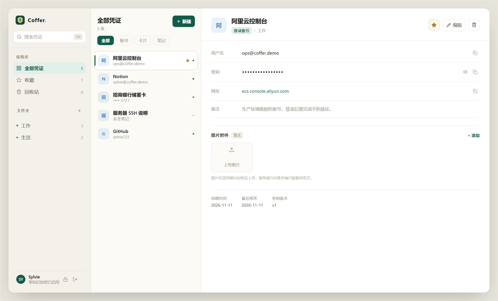
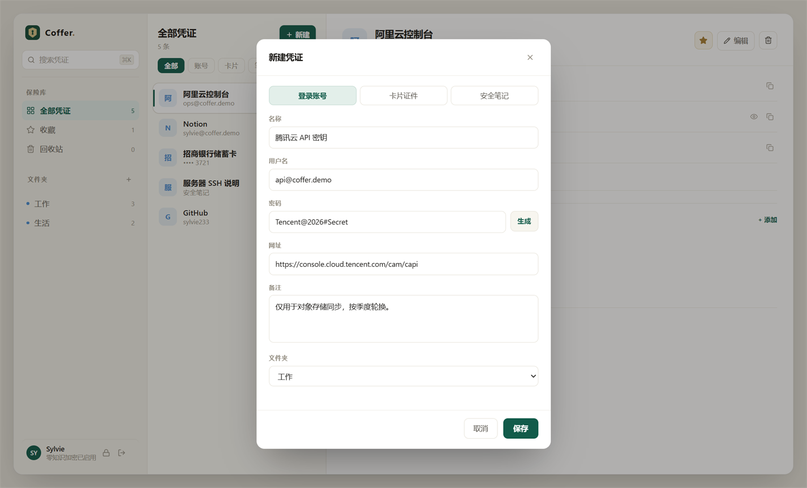
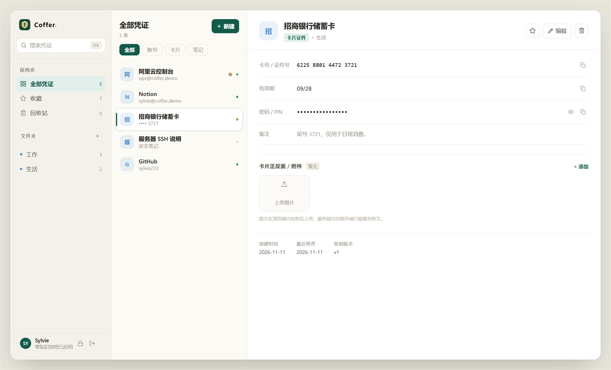
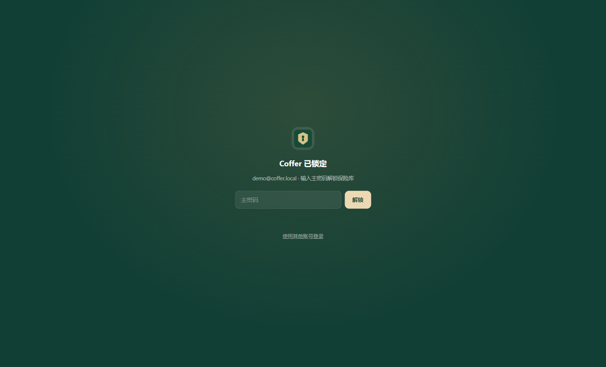
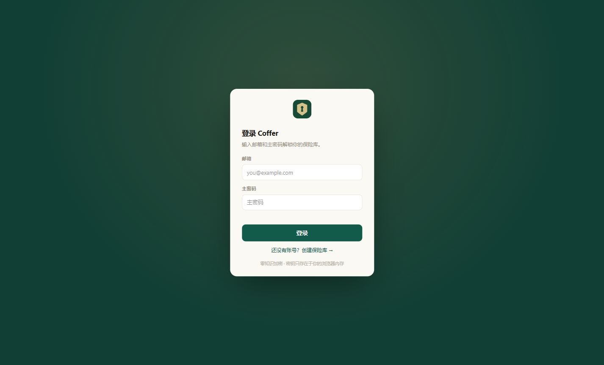

# Coffer · 零知识凭证管理器

> 账号密码、卡片证件、安全笔记与图片附件全部在客户端加密，服务端只保存密文。
> 主密码通过 Argon2id 派生密钥，登录使用 SRP-6a，密钥永不离开客户端。



## 功能特性

- **零知识加密**：Argon2id 派生密钥、SRP-6a 登录，字段与附件在客户端用 AES-256-GCM 加密，服务端只保存密文。
- **凭证管理**：账号、卡片、笔记三类条目，支持文件夹、收藏、搜索、排序与 30 天回收站。
- **加密附件**：图片在浏览器内加密后上传，RustFS 与数据库均只保存二进制密文。
- **二次验证**：查看敏感字段需重新输入主密码，解锁仅对当前条目生效。
- **主密码轮换**：修改主密码时全库重加密，旧密钥版本自动作废。
- **多端复用**：Web 与 Electron 共用 `@coffer/vault` 页面与组件；桌面端提供可自选目录的 NSIS 安装包。

## 页面预览

| 新建凭证 | 卡片证件 |
| --- | --- |
|  |  |

| 锁定页 | 登录页 |
| --- | --- |
|  |  |

## 技术栈

- **前端**：Next.js 15（静态导出）、React 19、Tailwind CSS v4
- **桌面端**：Electron Forge 8、Vite、React，NSIS 安装包
- **后端**：Node.js、Hono、Zod、MySQL 8、RustFS（S3 兼容）
- **共享包**：`@coffer/crypto`、`@coffer/db`、`@coffer/types`、`@coffer/utils`、`@coffer/ui`、`@coffer/vault-core`、`@coffer/vault`
- **工程**：pnpm workspace + Turborepo，Docker Compose 部署

## 快速开始

```powershell
# Docker 一键启动（MySQL + RustFS + API + Web），首次自动初始化数据库
pwsh ./manage.ps1 up
```

访问：

- Web：<http://localhost:8080>
- API 文档：<http://localhost:3000/api/docs>
- RustFS 控制台：<http://localhost:9001>

本地开发：

```bash
pwsh ./manage.ps1 up -Target mysql
docker compose -f scripts/docker-compose.yml up -d rustfs

cd coffer-monorepo
pnpm install
pnpm build          # 构建共享包
pnpm dev            # API :3000 + Web :3001
```

桌面端（复用 Web 页面）：

```bash
cd coffer-monorepo
pnpm desktop:dev                        # Forge 开发模式
pnpm desktop:make                       # 生成 NSIS 安装包
# 产物：apps/electron/out/make/Coffer-Setup-<version>.exe
```

安装包支持自选安装目录、桌面与开始菜单快捷方式；当前未签名，SmartScreen 会提示。

## 目录结构

```text
Coffer/
├── coffer-monorepo/
│   ├── apps/
│   │   ├── api/          # Hono API：routes / controllers / services / sql
│   │   ├── electron/     # Electron 主进程、preload 与渲染入口
│   │   └── web/          # Next.js 应用壳与静态资源
│   └── packages/         # crypto、db、types、utils、ui、vault-core、vault
├── docs/                 # 设计文档、SQL、PC/移动端原型与截图
├── scripts/              # Docker Compose 与环境变量示例
└── manage.ps1            # 启动、状态、日志、重置等运维入口
```

## 文档

- [docs/功能设计说明-v1.md](docs/功能设计说明-v1.md)：业务规则、加密流程与交互说明
- [docs/凭证管理器功能地图-v1.md](docs/凭证管理器功能地图-v1.md)：功能范围与优先级
- [docs/sql/coffer-v1.sql](docs/sql/coffer-v1.sql)：权威数据结构
- [docs/prototype/pc-v1.html](docs/prototype/pc-v1.html)：PC 端交互原型
- [docs/prototype/mobile-v1.html](docs/prototype/mobile-v1.html)：移动端交互原型
- [scripts/docker-compose.yml](scripts/docker-compose.yml)：容器编排

## License

[MIT](LICENSE)
